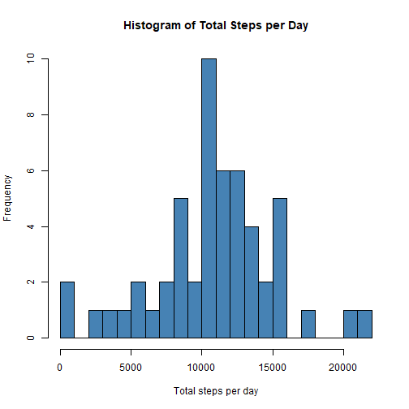
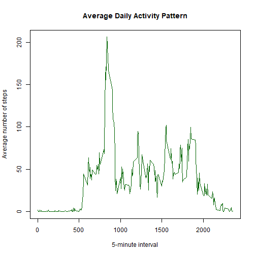
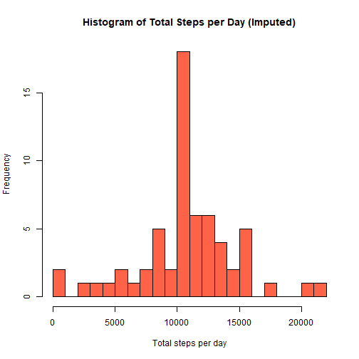
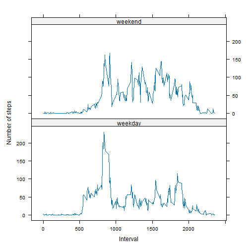

## Loading and preprocessing the data

The data file `activity.zip` comes with the forked repository. We unzip it, read it, and convert the `date` column to a `Date` class.


```r
if (!file.exists("activity.csv")) {
  unzip("activity.zip")
}
activity <- read.csv("activity.csv", stringsAsFactors = FALSE)
activity$date <- as.Date(activity$date, format = "%Y-%m-%d")

str(activity)
```

```
## 'data.frame':	17568 obs. of  3 variables:
##  $ steps   : int  NA NA NA NA NA NA NA NA NA NA ...
##  $ date    : Date, format: "2012-10-01" "2012-10-01" "2012-10-01" "2012-10-01" ...
##  $ interval: int  0 5 10 15 20 25 30 35 40 45 ...
```

```r
summary(activity)
```

```
##      steps             date               interval     
##  Min.   :  0.00   Min.   :2012-10-01   Min.   :   0.0  
##  1st Qu.:  0.00   1st Qu.:2012-10-16   1st Qu.: 588.8  
##  Median :  0.00   Median :2012-10-31   Median :1177.5  
##  Mean   : 37.38   Mean   :2012-10-31   Mean   :1177.5  
##  3rd Qu.: 12.00   3rd Qu.:2012-11-15   3rd Qu.:1766.2  
##  Max.   :806.00   Max.   :2012-11-30   Max.   :2355.0  
##  NA's   :2304
```

## What is mean total number of steps taken per day?

Missing values are ignored in this part.

**1. Total number of steps per day**


```r
daily_steps <- aggregate(steps ~ date, data = activity, FUN = sum, na.rm = TRUE)
head(daily_steps)
```

```
##         date steps
## 1 2012-10-02   126
## 2 2012-10-03 11352
## 3 2012-10-04 12116
## 4 2012-10-05 13294
## 5 2012-10-06 15420
## 6 2012-10-07 11015
```

**2. Histogram of total steps per day**


```r
hist(daily_steps$steps,
     breaks = 20,
     col = "steelblue",
     main = "Histogram of Total Steps per Day",
     xlab = "Total steps per day")
```



**3. Mean and median of total steps per day**


```r
mean_steps   <- mean(daily_steps$steps)
median_steps <- median(daily_steps$steps)
mean_steps
```

```
## [1] 10766.19
```

```r
median_steps
```

```
## [1] 10765
```

The mean total number of steps per day is **10766.19** and the median is **10765**.

## What is the average daily activity pattern?

**1. Time series plot of the average steps per 5-minute interval**


```r
interval_avg <- aggregate(steps ~ interval, data = activity, FUN = mean, na.rm = TRUE)

plot(interval_avg$interval, interval_avg$steps,
     type = "l",
     col = "darkgreen",
     main = "Average Daily Activity Pattern",
     xlab = "5-minute interval",
     ylab = "Average number of steps")
```



**2. Interval with the maximum average number of steps**


```r
max_row <- interval_avg[which.max(interval_avg$steps), ]
max_row
```

```
##     interval    steps
## 104      835 206.1698
```

Interval **835** has the highest average, about **206.2** steps.

## Imputing missing values

**1. Total number of missing values**


```r
sum(is.na(activity$steps))
```

```
## [1] 2304
```

**2. Strategy**

Each missing value is replaced by the mean number of steps for that same 5-minute interval, averaged across all days. This keeps the typical daily pattern intact.

**3. New dataset with missing values filled in**


```r
activity_imputed <- activity
na_idx <- is.na(activity_imputed$steps)

activity_imputed$steps[na_idx] <- interval_avg$steps[
  match(activity_imputed$interval[na_idx], interval_avg$interval)
]

sum(is.na(activity_imputed$steps))  # should be 0
```

```
## [1] 0
```

**4. Histogram, mean and median after imputation**


```r
daily_steps_imp <- aggregate(steps ~ date, data = activity_imputed, FUN = sum)

hist(daily_steps_imp$steps,
     breaks = 20,
     col = "tomato",
     main = "Histogram of Total Steps per Day (Imputed)",
     xlab = "Total steps per day")
```



```r
mean_imp   <- mean(daily_steps_imp$steps)
median_imp <- median(daily_steps_imp$steps)

data.frame(
  version = c("Original (NAs ignored)", "Imputed"),
  mean    = c(mean_steps, mean_imp),
  median  = c(median_steps, median_imp)
)
```

```
##                  version     mean   median
## 1 Original (NAs ignored) 10766.19 10765.00
## 2                Imputed 10766.19 10766.19
```

**Do the values differ?** The mean is essentially unchanged, because we filled gaps with interval means. The median moves slightly (it now equals the mean). The main effect is on the histogram: the 8 days that were entirely missing now each sit at the average daily total, so the center bin gets taller. Imputing this way increases the frequency of typical days without changing the overall average.

## Are there differences in activity patterns between weekdays and weekends?

**1. Weekday/weekend factor** (using `%u` so it does not depend on the system language)


```r
activity_imputed$daytype <- factor(
  ifelse(as.integer(format(activity_imputed$date, "%u")) >= 6, "weekend", "weekday"),
  levels = c("weekday", "weekend")
)
table(activity_imputed$daytype)
```

```
## 
## weekday weekend 
##   12960    4608
```

**2. Panel plot**


```r
library(lattice)

interval_daytype <- aggregate(steps ~ interval + daytype,
                              data = activity_imputed, FUN = mean)

xyplot(steps ~ interval | daytype,
       data = interval_daytype,
       type = "l",
       layout = c(1, 2),
       xlab = "Interval",
       ylab = "Number of steps")
```



On weekdays there is a pronounced morning peak and lower activity afterward, while weekends show activity spread more evenly through the day with a later start.
